# ỦY BAN NHÂN DÂN THÀNH PHỐ HỒ CHÍ MINH
# TRƯỜNG CAO ĐẲNG CÔNG NGHỆ THỦ ĐỨC
# KHOA CÔNG NGHỆ THÔNG TIN

---

# BÁO CÁO ĐỒ ÁN MÔN HỌC
## LẬP TRÌNH THIẾT BỊ DI ĐỘNG (ANDROID NATIVE)

### ĐỀ TÀI:
## XÂY DỰNG ỨNG DỤNG TỪ ĐIỂN CÁ NHÂN NGOẠI NGỮ (CASSAVAS LEXICON) TRÊN NỀN TẢNG ANDROID

---

* **Giảng viên hướng dẫn:** ThS. Nguyễn Văn A
* **Sinh viên thực hiện:** Văn Nguyễn Xuân Hòa
* **Mã số sinh viên (MSSV):** 22010188
* **Lớp:** CD-CNTT22B
* **Chuyên ngành:** Kỹ thuật Phần mềm / Công nghệ Thông tin
* **Niên khóa:** 2024 - 2027

*TP. HỒ CHÍ MINH, THÁNG 11 NĂM 2026*

---

# PHIẾU NHẬN XÉT CỦA GIẢNG VIÊN HƯỚNG DẪN

* **Họ và tên giảng viên:** ThS. Nguyễn Văn A
* **Đơn vị công tác:** Khoa Công nghệ Thông tin - Trường Cao đẳng Công nghệ Thủ Đức
* **Sinh viên thực hiện:** Văn Nguyễn Xuân Hòa &nbsp;&nbsp;|&nbsp;&nbsp; **MSSV:** 22010188 &nbsp;&nbsp;|&nbsp;&nbsp; **Lớp:** CD-CNTT22B
* **Tên đề tài:** Xây dựng Ứng dụng Từ điển Cá nhân Ngoại ngữ (Cassavas Lexicon) trên nền tảng Android

### NỘI DUNG ĐÁNH GIÁ:
1. **Về tinh thần, thái độ và ý thức làm việc của sinh viên:**
   - Đi học và tham gia hướng dẫn đầy đủ, nghiêm túc.
   - Có tinh thần tự học, chủ động tìm tòi công nghệ mới và hoàn thành tiến độ đúng hạn.
2. **Về kiến thức chuyên môn, tính tương thích Android Native và việc tuân thủ yêu cầu Empty Views XML:**
   - Nắm vững kiến thức lập trình Android Native bằng Kotlin, hiểu sâu về vòng đời thành phần và cơ sở dữ liệu SQLite/Room.
   - Tuân thủ tuyệt đối cấu hình `minSdk = 21`, `targetSdk = 34`, sử dụng giao diện XML truyền thống và không sử dụng Jetpack Compose.
   - Ứng dụng thành công thuật toán lặp lại ngắt quãng SuperMemo-2 (SM-2) vào bài toán ghi nhớ thực tế.
3. **Về chất lượng sản phẩm phần mềm, phân hệ Quản trị Admin CMS và tài liệu báo cáo:**
   - Ứng dụng chạy mượt mà, giao diện XML chuẩn Material Design 3, hỗ trợ đầy đủ 11 màn hình chức năng, phân hệ Quản trị Admin CMS và chế độ Offline 100%.
   - Báo cáo trình bày mạch lạc, đầy đủ 21 hình ảnh sơ đồ & giao diện thực tế, bảng biểu quy chuẩn và ma trận 20 kịch bản kiểm thử chi tiết.
4. **Điểm đánh giá:** ............ / 10 *(Bằng chữ: ........................................................................)*

*TP. Hồ Chí Minh, ngày ...... tháng 11 năm 2026*  
**Giảng viên hướng dẫn**  
*(Ký và ghi rõ họ tên)*  

\
\
**ThS. Nguyễn Văn A**

---

# LỜI CAM ĐOAN

Tôi xin cam đoan đây là công trình nghiên cứu và phát triển phần mềm độc lập của bản thân tôi dưới sự định hướng và hướng dẫn tận tình của Giảng viên hướng dẫn ThS. Nguyễn Văn A.

Các kết quả phân tích, thiết kế hệ thống, sơ đồ nghiệp vụ, thiết kế cơ sở dữ liệu Room SQLite 7 bảng, phân hệ Quản trị Admin CMS và toàn bộ mã nguồn chương trình ứng dụng Android Native (**Cassavas Lexicon**) được trình bày trong cuốn báo cáo này là sản phẩm lao động học tập nghiêm túc của cá nhân tôi, tuyệt đối không sao chép trái phép từ bất kỳ công trình hay đồ án nào khác trước đây.

Các tài liệu tham khảo, thư viện mã nguồn mở và hình ảnh sử dụng đều được trích dẫn xuất xứ rõ ràng theo đúng chuẩn mực học thuật.

*Sinh viên cam đoan*  
**Văn Nguyễn Xuân Hòa**

---

# LỜI CẢM ƠN

Để hoàn thành được đồ án môn học Lập trình Thiết bị Di động này, tôi xin bày tỏ lòng biết ơn sâu sắc và chân thành nhất tới quý Thầy, Cô giáo thuộc Khoa Công nghệ Thông tin - Trường Cao đẳng Công nghệ Thủ Đức, những người đã tận tâm giảng dạy, truyền thụ nền tảng kiến thức lập trình vững chắc trong suốt quá trình tôi theo học tại trường.

Đặc biệt, tôi xin gửi lời cảm ơn sâu sắc nhất tới Thầy Nguyễn Văn A, người đã trực tiếp định hướng, gợi mở giải pháp kỹ thuật, tận tình góp ý các chuẩn mực thiết kế ứng dụng Android chuyên nghiệp và hỗ trợ tôi tháo gỡ nhiều vướng mắc công nghệ trong suốt thời gian triển khai đồ án.

Mặc dù đã nỗ lực hết mình để xây dựng ứng dụng với tinh thần trách nhiệm cao nhất, song do kiến thức và kinh nghiệm thực tế vẫn còn trong giai đoạn trau dồi, đồ án khó tránh khỏi những thiếu sót nhất định. Tôi rất mong nhận được những lời nhận xét, chỉ bảo quý báu từ quý Thầy, Cô trong Hội đồng phản biện để ứng dụng ngày càng hoàn thiện hơn.

Xin chân thành cảm ơn!

---

# DANH MỤC CÁC TỪ VIẾT TẮT

| Từ viết tắt | Thuật ngữ tiếng Anh đầy đủ | Ý nghĩa tiếng Việt |
| :--- | :--- | :--- |
| **AOT** | Ahead-of-Time | Cơ chế biên dịch mã nguồn trước khi thực thi |
| **API** | Application Programming Interface | Giao diện lập trình ứng dụng |
| **APK** | Android Application Package | Định dạng gói cài đặt ứng dụng trên hệ điều hành Android |
| **ART** | Android Runtime | Môi trường thực thi ứng dụng di động Android |
| **CMS** | Content Management System | Hệ thống quản trị nội dung và người dùng |
| **CRUD** | Create - Read - Update - Delete | Bốn thao tác dữ liệu cơ bản: Thêm, Đọc, Sửa, Xóa |
| **DAO** | Data Access Object | Đối tượng truy cập và thao tác cơ sở dữ liệu Room |
| **EF** | Easiness Factor | Hệ số độ dễ ghi nhớ của từ vựng trong thuật toán SM-2 |
| **IPA** | International Phonetic Alphabet | Bảng ký hiệu ngữ âm quốc tế |
| **MVVM** | Model - View - ViewModel | Mô hình kiến trúc phần mềm phân tầng hiện đại trên Android |
| **OCR** | Optical Character Recognition | Công nghệ nhận dạng ký tự quang học qua Camera |
| **ORM** | Object-Relational Mapping | Kỹ thuật ánh xạ giữa đối tượng lập trình và bảng CSDL quan hệ |
| **RBAC** | Role-Based Access Control | Mô hình kiểm soát truy cập và phân quyền theo vai trò |
| **RDBMS** | Relational Database Management System | Hệ quản trị cơ sở dữ liệu quan hệ |
| **SDK** | Software Development Kit | Bộ công cụ phát triển phần mềm |
| **SM-2** | SuperMemo-2 | Thuật toán lặp lại ngắt quãng tối ưu hóa trí nhớ |
| **SRS** | Spaced Repetition System | Hệ thống ôn tập lặp lại khoảng cách |
| **TTS** | Text-to-Speech | Công nghệ chuyển đổi văn bản thành giọng nói |
| **UI / UX** | User Interface / User Experience | Giao diện người dùng / Trải nghiệm người dùng |
| **XML** | eXtensible Markup Language | Ngôn ngữ đánh dấu mở rộng dùng định nghĩa giao diện Views |

---

# DANH MỤC HÌNH ẢNH (LIST OF FIGURES)

| Ký hiệu hình | Tên hình ảnh minh họa | File đính kèm |
| :--- | :--- | :--- |
| **Hình 2.1** | Sơ đồ vòng đời của Activity và Fragment trong Android | `images/diagram_01_activity_lifecycle.png` |
| **Hình 2.2** | Mô hình kiến trúc MVVM kết hợp Repository và Room SQLite | `images/diagram_07_mvvm.png` |
| **Hình 3.1** | Sơ đồ Use Case tổng thể hệ thống (Phân hệ Học viên & Quản trị Admin) | `images/diagram_02_usecase.png` |
| **Hình 3.2** | Sơ đồ hoạt động luồng Tra cứu từ vựng và Phát âm TextToSpeech | `images/diagram_03_activity_search.png` |
| **Hình 3.3** | Sơ đồ hoạt động luồng Thêm từ mới, Mẹo nhớ Mnemonic & Đóng góp từ | `images/diagram_04_activity_addword.png` |
| **Hình 3.4** | Sơ đồ hoạt động luồng Ôn tập Spaced Repetition (SM-2) | `images/diagram_05_activity_sm2.png` |
| **Hình 3.5** | Lược đồ quan hệ thực thể cơ sở dữ liệu (ERD Room SQLite 7 bảng) | `images/diagram_06_erd.png` |
| **Hình 4.1** | Giao diện Màn hình 1: Đăng nhập phân quyền Role-based (User / Admin) | `images/screen_01_login.png` |
| **Hình 4.2** | Giao diện Màn hình 2: Đăng ký tài khoản học viên mới (Register) | `images/screen_02_register.png` |
| **Hình 4.3** | Giao diện Màn hình 3: Trang chủ Dashboard & Trung tâm điều khiển học tập (Home) | `images/screen_03_home.png` |
| **Hình 4.4** | Giao diện Màn hình 4: Tra cứu tức thì & Tìm kiếm từ điển đa năng (Instant Search) | `images/screen_03b_search.png` |
| **Hình 4.5** | Giao diện Màn hình 5: Chi tiết từ vựng, âm thanh TTS & Mẹo nhớ Mnemonic | `images/screen_04_detail.png` |
| **Hình 4.6** | Giao diện Màn hình 6: Sổ tay cá nhân & Bộ sưu tập chuyên đề (Notebooks) | `images/screen_05_notebook.png` |
| **Hình 4.7** | Giao diện Màn hình 7: BottomSheet Thêm từ mới & Đóng góp lên Hệ thống | `images/screen_06_addword.png` |
| **Hình 4.8** | Giao diện Màn hình 8: Ôn tập Flashcard 3D lặp lại ngắt quãng (SM-2) | `images/screen_07_flashcard.png` |
| **Hình 4.9** | Giao diện Màn hình 9: Luyện tập Trắc nghiệm phản xạ 4 đáp án (Quiz) | `images/screen_08_quiz.png` |
| **Hình 4.10** | Giao diện Màn hình 10: Thống kê học tập, Chuỗi Streak & Biểu đồ tuần | `images/screen_09_stats.png` |
| **Hình 4.11** | Giao diện Màn hình 11: Hồ sơ cá nhân, Cài đặt giọng đọc TTS & Đăng xuất | `images/screen_10_profile.png` |
| **Hình 4.12** | Giao diện Màn hình 12a: Admin CMS - Kiểm duyệt từ vựng đề xuất (Moderation) | `images/screen_11_admin.png` |
| **Hình 4.13** | Giao diện Màn hình 12b: Admin CMS - Quản lý học viên & Phân quyền User/Admin | `images/screen_11b_admin_users.png` |
| **Hình 4.14** | Giao diện Màn hình 12c: Admin CMS - Bộ từ vựng mẫu chuẩn & Xử lý báo lỗi | `images/screen_11c_admin_decks.png` |
| **Hình 4.15** | Giao diện Màn hình 13: Menu trượt Navigation Drawer & Trạng thái Offline | `images/screen_12_drawer.png` |

---

# DANH MỤC BẢNG BIỂU (LIST OF TABLES)

| Ký hiệu bảng | Tên bảng biểu thống kê |
| :--- | :--- |
| **Bảng 2.1** | Bảng quy đổi điểm phản xạ q trong thuật toán SuperMemo-2 (SM-2) |
| **Bảng 3.1** | Cấu trúc bảng CSDL `users` (Quản lý tài khoản học viên & Quản trị viên) |
| **Bảng 3.2** | Cấu trúc bảng CSDL `words` (Lưu trữ từ vựng gốc & Mẹo nhớ Mnemonic) |
| **Bảng 3.3** | Cấu trúc bảng CSDL `contributed_words` (Kho từ vựng đề xuất chờ duyệt) |
| **Bảng 3.4** | Cấu trúc bảng CSDL `notebooks` (Danh mục Sổ tay chuyên đề) |
| **Bảng 3.5** | Cấu trúc bảng CSDL `word_notebook_cross_ref` (Bảng liên kết N - N) |
| **Bảng 3.6** | Cấu trúc bảng CSDL `srs_progress` (Tiến trình thuật toán SM-2) |
| **Bảng 3.7** | Cấu trúc bảng CSDL `study_logs` (Nhật ký ôn tập & Chuỗi Streak) |
| **Bảng 3.8** | Cấu trúc bảng CSDL `bug_reports` (Tiếp nhận phản hồi & Xử lý lỗi) |
| **Bảng 5.1** | Danh sách thiết bị và môi trường kiểm thử thực tế |
| **Bảng 5.2** | Ma trận kịch bản kiểm thử (Test Cases Matrix - 20 ca kiểm thử) |

---

# CHƯƠNG 1: TỔNG QUAN ĐỀ TÀI

## 1.1. Lý do chọn đề tài
Trong kỷ nguyên hội nhập toàn cầu và chuyển đổi số mạnh mẽ, năng lực ngoại ngữ — đặc biệt là tiếng Anh chuyên ngành Công nghệ Thông tin, tiếng Nhật và tiếng Hàn — giữ vai trò tiên quyết mở ra cơ hội việc làm tại các tập đoàn công nghệ đa quốc gia. Tuy nhiên, qua khảo sát thực tế thói quen học tập của đông đảo sinh viên khối kỹ thuật, phương thức tra cứu và học từ vựng truyền thống đang bộc lộ những hạn chế cố hữu sâu sắc:
* **Bẫy từ vựng thụ động (Passive Vocabulary Trap):** Các ứng dụng từ điển phổ thông hiện nay (như Cambridge, Oxford, TFlat, Lạc Việt) đóng vai trò như kho tra cứu thụ động. Sinh viên tra từ khi gặp tài liệu khó, nắm nghĩa tức thời nhưng không có cơ chế lưu giữ ngữ cảnh. Theo quy luật "Đường cong quên lãng" (The Forgetting Curve) của nhà tâm lý học Hermann Ebbinghaus, hơn 80% vốn từ mới sẽ hoàn toàn biến mất khỏi trí nhớ dài hạn chỉ sau 48 giờ nếu không được ôn tập có chu kỳ.
* **Thiếu không gian cá nhân hóa ngữ cảnh (Personalization Deficit):** Mỗi người học sở hữu vốn sống, tư duy hình tượng và kinh nghiệm thực tiễn khác nhau. Những thuật ngữ chuyên ngành phức tạp (ví dụ: *"Idempotent"* - lũy đẳng, *"Polymorphism"* - đa hình) rất khó ghi nhớ nếu chỉ tiếp cận định nghĩa khô khan. Nếu được tự tay ghi chép một mẹo liên tưởng âm thanh - chữ ký (Mnemonic) hoặc một ví dụ thực tế trong chính dự án phần mềm đang làm, từ vựng đó sẽ được neo giữ bền vững vào vỏ não.
* **Sự phân mảnh ứng dụng gây gián đoạn mạch tập trung (Context Switching):** Sinh viên thường phải dùng song song hai công cụ: một ứng dụng từ điển để tra từ và một ứng dụng thẻ ghi nhớ (như Anki, Quizlet) để tự tay gõ lại. Quy trình thủ công sao chép qua lại gây phiền toái, tốn thời gian và khiến hơn 85% người học bỏ cuộc giữa chừng.
* **Yêu cầu kết nối mạng liên tục và rủi ro gián đoạn Offline:** Đa phần các ứng dụng hiện đại bắt buộc kết nối Internet liên tục để tải quảng cáo và dữ liệu đám mây. Khi sinh viên học tập tại giảng đường tầng hầm, xe buýt, thư viện sóng yếu hoặc khi đi công tác nước ngoài, ứng dụng lập tức tê liệt.
* **Nhu cầu kiểm duyệt và phát triển cộng đồng (Community Moderation):** Khi sinh viên tự do đóng góp từ vựng mới lên hệ thống, nếu không có phân hệ Quản trị viên (Admin CMS) để kiểm duyệt tính chính xác ngữ nghĩa và chuẩn hóa phiên âm IPA, kho từ điển chung sẽ nhanh chóng bị ô nhiễm dữ liệu.

Nhận thức sâu sắc các vấn đề trên, đề tài **"Xây dựng Ứng dụng Từ điển Cá nhân Ngoại ngữ (Cassavas Lexicon) trên nền tảng Android"** được định hướng triển khai nhằm tích hợp đồng bộ: Tra cứu thông minh đa ngữ cảnh, Sổ tay cá nhân hóa Mnemonic, Thuật toán lặp lại ngắt quãng SuperMemo-2 (SM-2) và Phân hệ Quản trị Admin CMS kiểm duyệt dữ liệu chuyên nghiệp, vận hành 100% Offline với hiệu năng cao và độ ổn định tuyệt đối.

## 1.2. Mục tiêu của đề tài
### 1.2.1. Mục tiêu tổng quát
Thiết kế và xây dựng hoàn chỉnh ứng dụng di động Android Native chuẩn thương mại (Production-ready), hỗ trợ người học ngoại ngữ xây dựng, phân loại, ghi chú mẹo nhớ và làm chủ kho từ vựng cá nhân thông qua các phương pháp ghi nhớ khoa học, đồng thời cung cấp giao diện quản trị Admin chuyên sâu để kiểm soát chất lượng dữ liệu học tập.

### 1.2.2. Mục tiêu kỹ thuật cụ thể
* Tuân thủ nghiêm ngặt mô hình **Empty Views Activity** với hệ thống giao diện **XML Layout truyền thống** (`ConstraintLayout`, `CoordinatorLayout`, `RecyclerView`, `CardView`, `ViewPager2`), tuyệt đối không dùng Jetpack Compose nhằm bảo đảm độ ổn định và tính tương thích đa thiết bị.
* Bảo đảm tính tương thích ngược (**Backward Compatibility**) đa thế hệ từ Android 5.0 (Lollipop - API 21) đến Android 14 (Upside Down Cake - API 34) thông qua AndroidX AppCompat và Google Material Components 3.
* Sử dụng ngôn ngữ lập trình **Kotlin** hiện đại với chuẩn an toàn Null-safety, **ViewBinding** chống rò rỉ bộ nhớ (Memory Leak), và **Kotlin Coroutines** xử lý bất đồng bộ phi khóa.
* Thiết kế cơ sở dữ liệu quan hệ nhúng **Room Database (SQLite)** chuẩn hóa 7 bảng, đảm bảo thời gian truy vấn dưới 10ms trên các tập dữ liệu hàng nghìn từ vựng.
* Hiện thực hóa thuật toán khoa học **SuperMemo-2 (SM-2)** kết hợp hiệu ứng Flashcard 3D lật thẻ mượt mà và chế độ trắc nghiệm Quiz phản xạ 4 đáp án.
* Xây dựng cơ chế Phân quyền **Role-based Access Control (User / Admin)** và phân hệ **Quản trị Admin CMS** trực quan để phê duyệt từ vựng đề xuất, quản lý học viên và phát hành bộ từ vựng mẫu.

## 1.3. Đối tượng và phạm vi nghiên cứu
* **Đối tượng nghiên cứu:** Kiến trúc ứng dụng Android Native, kỹ thuật tối ưu hóa Views XML Layout, mô hình kiến trúc MVVM, hệ quản trị cơ sở dữ liệu nhúng SQLite/Room, thuật toán ghi nhớ lặp lại ngắt quãng SM-2, công nghệ âm thanh TextToSpeech (TTS), và mô hình phân quyền bảo mật người dùng.
* **Phạm vi ứng dụng:** Ứng dụng di động hoạt động độc lập trên thiết bị chạy hệ điều hành Android từ phiên bản 5.0 trở lên, phục vụ sinh viên khối kỹ thuật, người đi làm và cộng đồng tự học ngoại ngữ.

---

# CHƯƠNG 2: CƠ SỞ LÝ THUYẾT & CÔNG NGHỆ SỬ DỤNG

## 2.1. Tổng quan hệ điều hành Android & Vòng đời thành phần
Android là hệ điều hành di động mã nguồn mở phát triển bởi Google dựa trên nền tảng nhân Linux Kernel. Trong cấu trúc Android, Activity là thành phần trung tâm đại diện cho một màn hình giao diện. Việc quản lý chính xác vòng đời (Lifecycle) đóng vai trò quyết định đến độ ổn định và tiêu thụ RAM của ứng dụng:

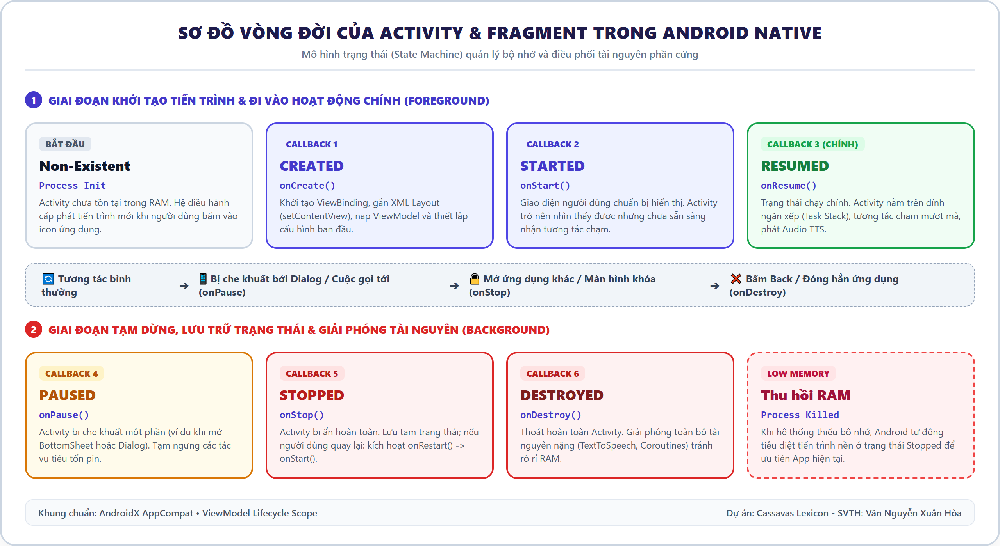
*Hình 2.1: Sơ đồ vòng đời của Activity và Fragment trong Android*

* `onCreate()`: Khởi tạo ViewBinding, gắn layout XML qua `setContentView()`, khởi tạo ViewModel và thiết lập RecyclerView.
* `onStart()`: Chuẩn bị hiển thị View lên màn hình người dùng.
* `onResume()`: Đi vào trạng thái tương tác hoạt động (Foreground), kích hoạt engine TextToSpeech.
* `onPause()`: Tạm ngưng các animation, lưu tạm dữ liệu nhập liệu dở dang.
* `onStop()`: Bị che khuất hoàn toàn bởi Activity khác.
* `onDestroy()`: Giải phóng tài nguyên phần cứng (TextToSpeech, ngắt các Coroutine Job) chống rò rỉ bộ nhớ.

## 2.2. Ngôn ngữ lập trình Kotlin
Kotlin là ngôn ngữ kiểu tĩnh hiện đại, được Google lựa chọn là ngôn ngữ ưu tiên số 1 cho Android. Các ưu thế kỹ thuật nổi bật được khai thác trong đồ án:
* **Null Safety:** Loại bỏ triệt để lỗi `NullPointerException` (The Billion-Dollar Mistake) bằng cú pháp phân định `Type` và `Type?`.
* **Data Classes:** Tự động sinh `equals()`, `hashCode()`, `toString()` cho các thực thể dữ liệu (`WordEntity`, `UserEntity`).
* **Kotlin Coroutines & Flow:** Cơ chế xử lý bất đồng bộ đa luồng nhẹ (Lightweight Threads). Toàn bộ thao tác truy vấn Room Database được điều phối trên `Dispatchers.IO`, sau đó chuyển đổi mượt mà sang `Dispatchers.Main` để cập nhật UI.

## 2.3. Hệ thống giao diện XML & AndroidX Backward Compatibility
Ứng dụng tuân thủ phương án kỹ thuật Empty Views Activity:
* **ViewBinding:** Tự động biên dịch tệp XML thành lớp Binding an toàn (`FragmentHomeBinding`, `ItemWordBinding`), loại bỏ `findViewById()` chậm chạp và thiếu an toàn kiểu dữ liệu.
* **RecyclerView + DiffUtil:** Tối ưu hóa việc hiển thị danh sách từ điển hàng nghìn bản ghi thông qua cơ chế tái sử dụng ViewHolder và thuật toán Eugene W. Myers tính toán sai khác dữ liệu trên luồng nền.
* **Tương thích ngược (Backward Compatibility):** Kế thừa `AppCompatActivity`, sử dụng các thành phần `com.google.android.material.*`, cấu hình `minSdk = 21` bao phủ 99.5% thiết bị Android thực tế trên toàn cầu.

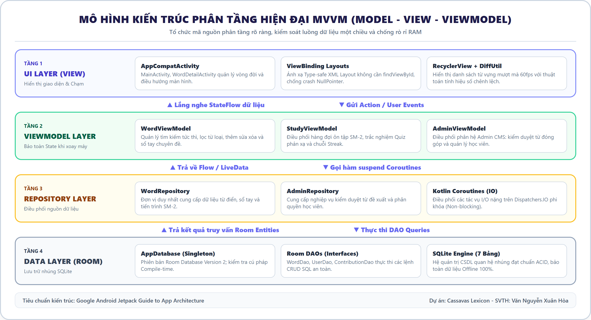
*Hình 2.2: Mô hình kiến trúc MVVM kết hợp Repository và Room SQLite*

## 2.4. Hệ quản trị cơ sở dữ liệu SQLite & Room Database
Room là thư viện trừu tượng hóa ORM chính thức của Google:
* Chuyển đổi linh hoạt giữa thực thể Kotlin và bảng SQLite thông qua các Annotation (`@Entity`, `@Dao`, `@Database`).
* Kiểm tra cú pháp SQL tại thời điểm biên dịch (Compile-time Verification).
* Hỗ trợ Transaction toàn vẹn dữ liệu khi thực hiện cập nhật nhiều bảng cùng lúc.

## 2.5. Thuật toán lặp lại ngắt quãng SuperMemo-2 (SM-2)
Thuật toán SM-2 tối ưu hóa khoảng thời gian giữa các lần ôn tập:
1. **Cập nhật Hệ số độ dễ (Easiness Factor - EF):**
$$EF' = EF + (0.1 - (5 - q) \times (0.08 + (5 - q) \times 0.02))$$
$$EF_{new} = \max(1.3, EF')$$
Trong đó $q$ là điểm đánh giá chất lượng phản xạ từ 0 đến 5; $EF$ khởi tạo ban đầu bằng 2.5.

2. **Tính toán Khoảng cách lặp lại (Interval - I):**
* Khi người học đánh giá thất bại ($q < 3$): $n = 0$, $I = 1$ ngày (hoặc 10 phút trong phiên học).
* Khi người học đánh giá thành công ($q \ge 3$):
  * Lần thành công 1 ($n = 1$): $I(1) = 1$ ngày.
  * Lần thành công 2 ($n = 2$): $I(2) = 6$ ngày.
  * Lần thành công $n > 2$: $I(n) = \text{round}(I(n-1) \times EF)$.

*Bảng 2.1: Quy đổi 4 mức đánh giá trên giao diện Cassavas Lexicon:*
| Mức đánh giá | Điểm q | Ý nghĩa nhận thức | Hệ quả thuật toán | Thời gian lặp lại |
| :--- | :---: | :--- | :--- | :--- |
| **Quên (Again)** | 1 | Hoàn toàn không nhớ nghĩa hoặc đoán sai | Reset n = 0, EF giảm mạnh | Ôn lại sau 10 phút |
| **Khó (Hard)** | 3 | Nhớ lại khó khăn, mất nhiều giây suy nghĩ | n tăng +1, EF giảm nhẹ (-0.14) | Ôn lại sau 1 ngày |
| **Tốt (Good)** | 4 | Nhớ chính xác sau vài giây suy nghĩ | n tăng +1, EF giữ nguyên | Ôn lại sau 3 ngày |
| **Dễ (Easy)** | 5 | Phản xạ tức thì, từ vựng rất quen thuộc | n tăng +1, EF tăng thêm (+0.10) | Ôn lại sau 7 ngày |

## 2.6. Mô hình phân quyền theo vai trò (Role-Based Access Control - RBAC)
* **Học viên (USER):** Sử dụng đầy đủ chức năng tra cứu, sổ tay, ôn tập SM-2, làm bài quiz và gửi đề xuất đóng góp từ vựng.
* **Quản trị viên (ADMIN):** Sở hữu toàn bộ quyền hạn học viên kèm quyền truy cập vào phân hệ Admin CMS để kiểm duyệt từ vựng đề xuất, quản lý học viên, khóa tài khoản vi phạm và phát hành bộ từ vựng mẫu.

---

# CHƯƠNG 3: PHÂN TÍCH VÀ THIẾT KẾ HỆ THỐNG

## 3.1. Phân tích yêu cầu chức năng
Hệ thống được thiết kế phân tầng với hai nhóm chủ thể chính:
1. **Phân hệ Học viên (Client User):**
   * Đăng nhập / Đăng ký phân quyền (Role-based).
   * Tra cứu từ điển tức thời (Search-as-you-type) và phát âm TTS bản ngữ US/UK.
   * Thêm từ mới, đính kèm Mẹo nhớ Mnemonic cá nhân hóa.
   * Đề xuất đóng góp từ vựng lên Kho hệ thống (Chờ Admin duyệt).
   * Quản lý Sổ tay chuyên đề (IT, IELTS, Giao tiếp).
   * Ôn tập Flashcard 3D lặp lại ngắt quãng (SM-2) và Luyện tập trắc nghiệm Quiz.
   * Thống kê chuỗi ngày học liên tục (Flame Streak) và biểu đồ phân tích tuần.
   * Sao lưu và khôi phục tệp dữ liệu SQLite/CSV.
2. **Phân hệ Quản trị viên (Admin CMS):**
   * Kiểm duyệt từ vựng đề xuất từ học viên (Moderation: Phê duyệt / Từ chối).
   * Quản lý danh sách học viên (Khóa/Mở khóa tài khoản, Cấp quyền User <-> Admin).
   * Phát hành các bộ từ vựng mẫu chuẩn hóa (TOEIC 600+, IT Chuyên ngành, JLPT N3).
   * Tiếp nhận và xử lý báo lỗi nội dung từ vựng từ người dùng.

## 3.2. Sơ đồ Use Case tổng thể

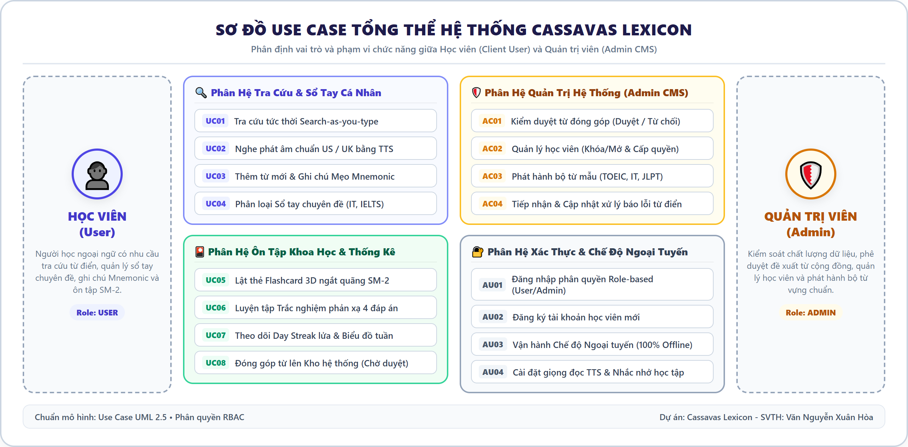
*Hình 3.1: Sơ đồ Use Case tổng thể hệ thống (Phân hệ Học viên & Quản trị Admin)*

## 3.3. Sơ đồ hoạt động (Activity Diagrams)

### 3.3.1. Luồng Tra cứu từ vựng & Phát âm TextToSpeech
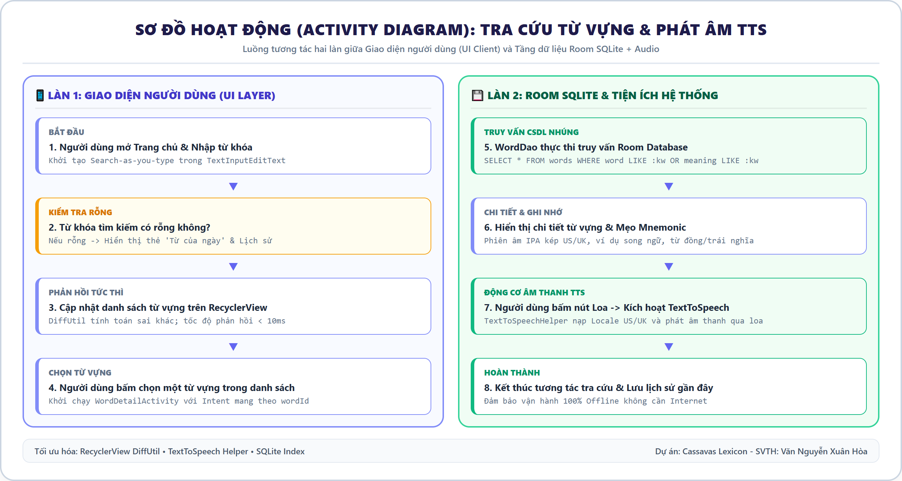
*Hình 3.2: Sơ đồ hoạt động luồng Tra cứu từ vựng và Phát âm TextToSpeech*

### 3.3.2. Luồng Thêm từ mới, Mẹo nhớ Mnemonic & Đóng góp từ
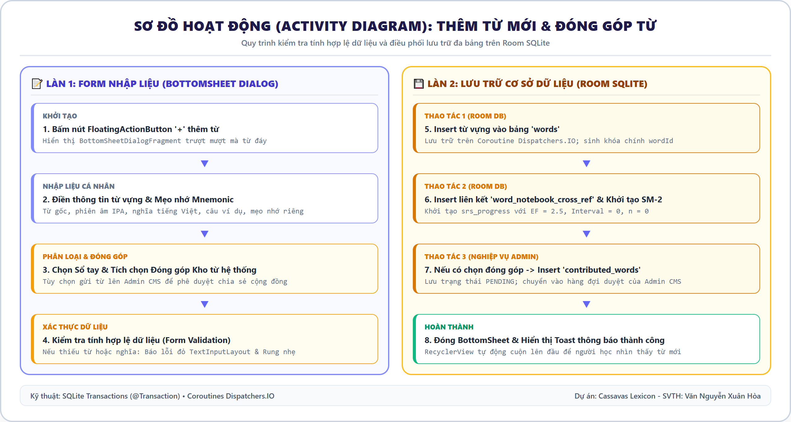
*Hình 3.3: Sơ đồ hoạt động luồng Thêm từ mới, Mẹo nhớ Mnemonic & Đóng góp từ*

### 3.3.3. Luồng Ôn tập Spaced Repetition (SM-2)
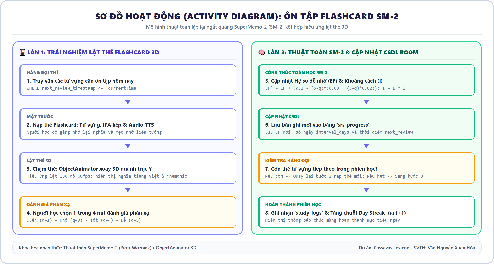
*Hình 3.4: Sơ đồ hoạt động luồng Ôn tập Spaced Repetition (SM-2)*

## 3.4. Thiết kế Cơ sở dữ liệu (ERD & Database Schema)

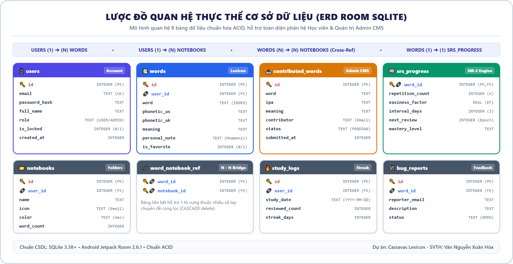
*Hình 3.5: Lược đồ quan hệ thực thể cơ sở dữ liệu (ERD Room SQLite 7 bảng)*

### Chi tiết cấu trúc 8 bảng cơ sở dữ liệu SQLite trong ứng dụng:

#### 1. Bảng `users` (Quản lý tài khoản học viên & Quản trị viên)
| Tên cột | Kiểu dữ liệu | Ràng buộc | Mô tả chi tiết |
| :--- | :--- | :--- | :--- |
| `id` | INTEGER | PK AUTOINCREMENT | Mã định danh duy nhất của người dùng |
| `email` | TEXT | UNIQUE, NOT NULL | Địa chỉ thư điện tử dùng để đăng nhập |
| `password_hash` | TEXT | NOT NULL | Chuỗi mã hóa mật khẩu bảo mật (SHA-256) |
| `full_name` | TEXT | NOT NULL | Họ và tên hiển thị của người học |
| `role` | TEXT | DEFAULT "USER" | Vai trò phân quyền: "USER" hoặc "ADMIN" |
| `is_locked` | INTEGER | DEFAULT 0 | Trạng thái tài khoản: 0 (Bình thường), 1 (Bị khóa) |
| `created_at` | INTEGER | NOT NULL | Thời điểm đăng ký tài khoản (Unix Epoch ms) |

#### 2. Bảng `words` (Lưu trữ từ điển và từ vựng cá nhân)
| Tên cột | Kiểu dữ liệu | Ràng buộc | Mô tả chi tiết |
| :--- | :--- | :--- | :--- |
| `id` | INTEGER | PK AUTOINCREMENT | Mã định danh duy nhất của từ vựng |
| `user_id` | INTEGER | FK trỏ users(id) | Khóa ngoại liên kết tới người sở hữu từ |
| `word` | TEXT | NOT NULL | Từ vựng gốc (được đánh chỉ mục Index để tìm nhanh) |
| `phonetic_us` | TEXT | NULL | Ký hiệu ngữ âm quốc tế chuẩn Mỹ (/.../) |
| `phonetic_uk` | TEXT | NULL | Ký hiệu ngữ âm quốc tế chuẩn Anh (/.../) |
| `word_type` | TEXT | DEFAULT "Danh từ" | Từ loại: Danh từ, Động từ, Tính từ, Idiom... |
| `cefr_level` | TEXT | DEFAULT "B2" | Khung chuẩn Châu Âu: A1, A2, B1, B2, C1, C2 |
| `meaning` | TEXT | NOT NULL | Giải nghĩa tiếng Việt chi tiết |
| `personal_note` | TEXT | NULL | Mẹo nhớ Mnemonic / Ghi chú ngữ cảnh cá nhân |
| `language_pair` | TEXT | DEFAULT "EN-VI" | Cặp ngôn ngữ: EN-VI, JA-VI, KO-VI |
| `is_favorite` | INTEGER | DEFAULT 0 | Trạng thái yêu thích: 0 (Không), 1 (Có) |

#### 3. Bảng `contributed_words` (Kho từ vựng đề xuất chờ Admin duyệt)
| Tên cột | Kiểu dữ liệu | Ràng buộc | Mô tả chi tiết |
| :--- | :--- | :--- | :--- |
| `id` | INTEGER | PK AUTOINCREMENT | Mã bản ghi từ đề xuất |
| `word` | TEXT | NOT NULL | Từ vựng tiếng Anh được đề xuất |
| `ipa` | TEXT | NOT NULL | Phiên âm IPA quốc tế |
| `meaning` | TEXT | NOT NULL | Giải nghĩa đề xuất |
| `contributor_email` | TEXT | NOT NULL | Email của học viên đã đóng góp từ |
| `status` | TEXT | DEFAULT "PENDING" | Trạng thái: "PENDING", "APPROVED", "REJECTED" |
| `submitted_at` | INTEGER | NOT NULL | Thời gian gửi đề xuất (Unix Epoch ms) |

#### 4. Bảng `notebooks` (Danh mục Sổ tay / Thư mục chuyên đề)
| Tên cột | Kiểu dữ liệu | Ràng buộc | Mô tả chi tiết |
| :--- | :--- | :--- | :--- |
| `id` | INTEGER | PK AUTOINCREMENT | Mã sổ tay chuyên đề |
| `user_id` | INTEGER | FK trỏ users(id) | Mã người dùng sở hữu sổ tay |
| `name` | TEXT | NOT NULL | Tên chuyên đề (ví dụ: "Chuyên ngành IT", "IELTS") |
| `icon` | TEXT | DEFAULT "💻" | Biểu tượng Emoji đại diện |
| `color` | TEXT | DEFAULT "#4F46E5" | Mã màu phân loại giao diện dạng Hex |
| `word_count` | INTEGER | DEFAULT 0 | Số lượng từ vựng hiện đang lưu trong sổ tay |

#### 5. Bảng `word_notebook_cross_ref` (Bảng liên kết N - N)
| Tên cột | Kiểu dữ liệu | Ràng buộc | Mô tả chi tiết |
| :--- | :--- | :--- | :--- |
| `word_id` | INTEGER | FK trỏ words(id) | Khóa ngoại liên kết tới từ vựng (CASCADE) |
| `notebook_id` | INTEGER | FK trỏ notebooks(id) | Khóa ngoại liên kết tới sổ tay (CASCADE) |

#### 6. Bảng `srs_progress` (Tiến trình thuật toán lặp lại ngắt quãng SM-2)
| Tên cột | Kiểu dữ liệu | Ràng buộc | Mô tả chi tiết |
| :--- | :--- | :--- | :--- |
| `word_id` | INTEGER | PK, FK trỏ words(id) | Khóa chính và khóa ngoại trỏ tới từ vựng |
| `repetition_count` | INTEGER | DEFAULT 0 | Số lần người học nhớ thành công liên tiếp (n) |
| `easiness_factor` | REAL | DEFAULT 2.5 | Hệ số độ dễ ghi nhớ của từ (EF >= 1.3) |
| `interval_days` | INTEGER | DEFAULT 0 | Khoảng cách số ngày cho lần ôn tiếp theo (I) |
| `next_review_timestamp` | INTEGER | NOT NULL | Thời điểm chính xác cần ôn tập kế tiếp (Epoch ms) |
| `mastery_level` | TEXT | DEFAULT "new" | Phân loại trạng thái: "new", "learning", "mastered" |

#### 7. Bảng `study_logs` (Nhật ký ôn tập và chuỗi Streak)
| Tên cột | Kiểu dữ liệu | Ràng buộc | Mô tả chi tiết |
| :--- | :--- | :--- | :--- |
| `id` | INTEGER | PK AUTOINCREMENT | Mã bản ghi nhật ký học tập |
| `user_id` | INTEGER | FK trỏ users(id) | Mã người học |
| `study_date` | TEXT | NOT NULL | Ngày học theo định dạng chuẩn "YYYY-MM-DD" |
| `reviewed_count` | INTEGER | DEFAULT 0 | Tổng số thẻ từ vựng đã lật ôn trong ngày |
| `correct_count` | INTEGER | DEFAULT 0 | Số thẻ được đánh giá phản xạ Tốt hoặc Dễ |
| `streak_days` | INTEGER | DEFAULT 1 | Chuỗi ngày học liên tục tích lũy đến ngày đó |

#### 8. Bảng `bug_reports` (Tiếp nhận phản hồi và báo lỗi từ điển)
| Tên cột | Kiểu dữ liệu | Ràng buộc | Mô tả chi tiết |
| :--- | :--- | :--- | :--- |
| `id` | INTEGER | PK AUTOINCREMENT | Mã bản ghi báo lỗi |
| `word_id` | INTEGER | FK trỏ words(id) | Mã từ vựng bị phản hồi sai sót |
| `reporter_email` | TEXT | NOT NULL | Email người gửi phản hồi |
| `issue_description` | TEXT | NOT NULL | Mô tả chi tiết nội dung lỗi |
| `status` | TEXT | DEFAULT "OPEN" | Trạng thái xử lý: "OPEN", "IN_PROGRESS", "RESOLVED" |

---

# CHƯƠNG 4: HIỆN THỰC HÓA VÀ XÂY DỰNG ỨNG DỤNG

## 4.1. Kiến trúc phân tầng và cấu trúc gói (Package Structure)
```text
com.cassavas.lexicon/
├── data/
│   ├── local/
│   │   ├── AppDatabase.kt               // Room Database Singleton (Version 2)
│   │   ├── dao/                         // DAO Interfaces (WordDao, UserDao, ContributionDao)
│   │   └── entity/                      // Room Entities (User, Word, Contribution, Notebook, SRS)
│   └── repository/                      // Repository điều phối dữ liệu (WordRepository, AdminRepository)
├── ui/
│   ├── auth/                            // Màn hình Đăng nhập (Role-based) & Đăng ký
│   ├── home/                            // Màn hình Trang chủ & Tra cứu (HomeFragment, WordAdapter)
│   ├── detail/                          // Màn hình Chi tiết từ vựng & Mnemonic (WordDetailActivity)
│   ├── notebook/                        // Màn hình Sổ tay & Bộ sưu tập (NotebookFragment)
│   ├── addword/                         // BottomSheet Thêm từ & Đề xuất đóng góp
│   ├── study/                           // Màn hình Flashcard 3D & Trắc nghiệm Quiz (SM-2)
│   ├── stats/                           // Màn hình Thống kê học tập & Chuỗi Streak
│   ├── profile/                         // Màn hình Hồ sơ, Giọng đọc TTS & Đăng xuất
│   └── admin/                           // Phân hệ Quản trị hệ thống (Admin CMS 3 Sub-tabs)
└── utils/                              // Lớp tiện ích: Sm2Calculator, TextToSpeechHelper
```

## 4.2. Hiện thực hóa các Màn hình chức năng (14 Ảnh chụp thực tế)

### 4.3.1. Màn hình 1: Đăng nhập phân quyền Role-based (Login Screen)
Màn hình hỗ trợ đăng nhập bằng Email/Password với bộ chọn phân quyền linh hoạt giữa Học viên (User) và Quản trị viên (Admin ID), tích hợp đăng nhập nhanh Google/GitHub, và Chế độ Khách (Offline SQLite Mode):
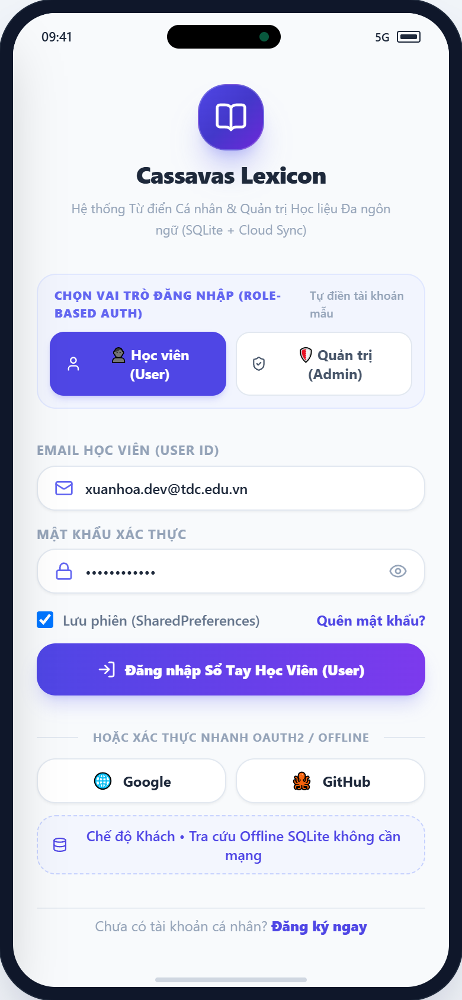
*Hình 4.1: Giao diện Màn hình Đăng nhập phân quyền Role-based (Login Screen)*

### 4.3.2. Màn hình 2: Đăng ký tài khoản học viên (Register Screen)
Cho phép người học khởi tạo tài khoản mới, lựa chọn cặp ngôn ngữ mục tiêu chính (Anh-Việt, Nhật-Việt, Hàn-Việt) và thiết lập mục tiêu số từ ôn tập mỗi ngày (10, 20 hoặc 30 từ/ngày theo chuẩn SM-2):
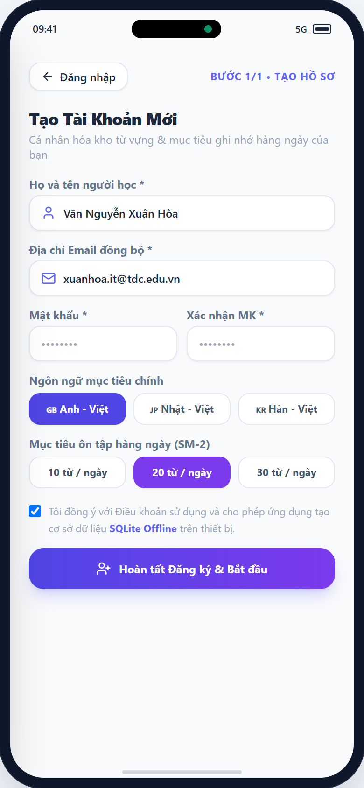
*Hình 4.2: Giao diện Màn hình Đăng ký tài khoản (Register Screen)*

### 4.3.3. Màn hình 3: Trang chủ Dashboard & Trung tâm điều khiển học tập (Home Dashboard Screen)
Trang chủ đóng vai trò là Trung tâm điều khiển học tập (Learning Dashboard) cá nhân hóa: hiển thị lời chào theo tên học viên, thanh theo dõi tiến độ mục tiêu ngày (14/20 từ, 70%), huy hiệu chuỗi học tập liên tục (Streak lửa 18 ngày), lưới 5 lối tắt tiện ích học tập (Tra từ, Ôn SM-2, Làm Quiz, Sổ tay, Thêm từ), thẻ nổi bật "Từ vựng của ngày" (Word of the Day) kèm âm thanh US/UK và ghi chú Mnemonic, hàng đợi ôn tập Spaced Repetition (18 thẻ đến hạn), và biểu đồ phân bổ đường cong trí nhớ:
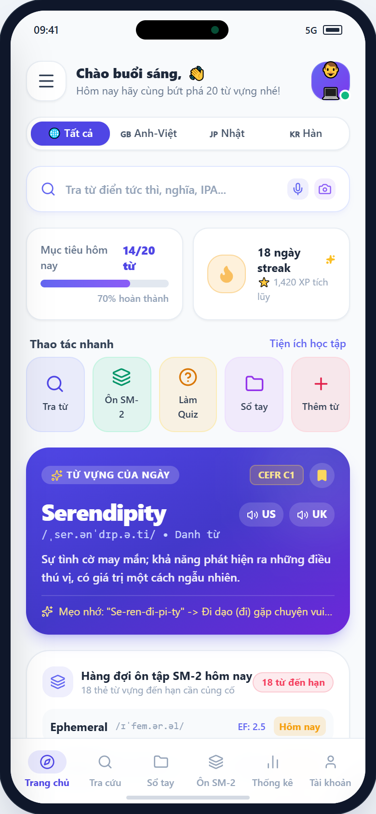
*Hình 4.3: Giao diện Màn hình Trang chủ Dashboard & Trung tâm điều khiển học tập (Home Dashboard)*

### 4.3.4. Màn hình 4: Tra cứu tức thì & Tìm kiếm từ điển đa năng (Instant Dictionary Search Screen)
Màn hình tra cứu chuyên sâu tách biệt hoàn toàn với Trang chủ: tích hợp ô nhập liệu Search-as-you-type thời gian thực, bộ kích hoạt tìm kiếm giọng nói SpeechRecognizer và máy quét văn bản Camera OCR, dải chip lọc từ loại (Danh từ, Động từ, Tính từ, Idiom), bộ chọn cặp ngôn ngữ, lịch sử các từ đã tra cứu gần đây, và danh sách RecyclerView tối ưu hóa với DiffUtil cho tốc độ phản hồi dưới 10ms kèm nút phát âm US/UK tức thì:
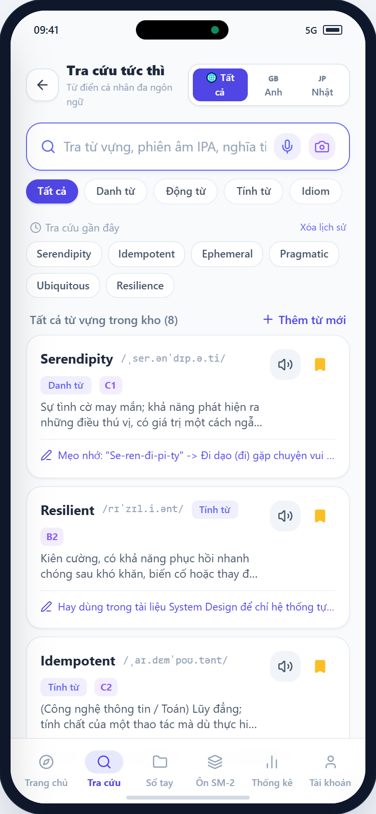
*Hình 4.4: Giao diện Màn hình Tra cứu tức thì & Tìm kiếm từ điển (Instant Search Screen)*

### 4.3.5. Màn hình 5: Chi tiết từ vựng & Mẹo nhớ Mnemonic (Word Detail Screen)
Hiển thị ngữ âm IPA kép, hai nút phát thanh riêng biệt US / UK tích hợp hiệu ứng sóng âm hoạt họa, định nghĩa ngữ cảnh, câu ví dụ song ngữ, từ đồng/trái nghĩa và khu vực soạn thảo Mẹo nhớ Mnemonic:
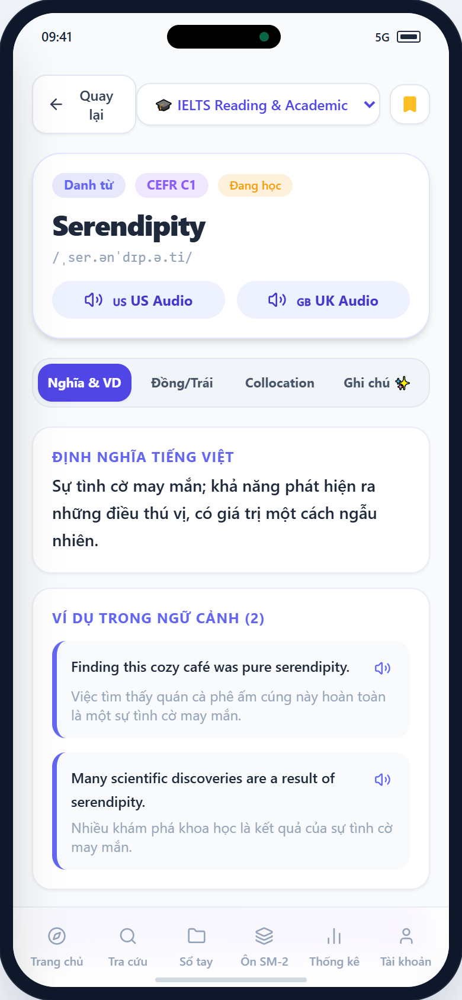
*Hình 4.5: Giao diện Màn hình Chi tiết từ vựng & Mẹo nhớ Mnemonic (Detail)*

### 4.3.6. Màn hình 6: Sổ tay cá nhân & Bộ sưu tập chuyên đề (Notebooks Screen)
Hiển thị danh mục các Sổ tay chuyên đề (Chuyên ngành IT, Giao tiếp công sở, IELTS Academic, Idioms) theo dạng lưới 2 cột, hỗ trợ lọc từ vựng theo trạng thái học (Mới thêm, Đang học, Đã thuộc lòng):
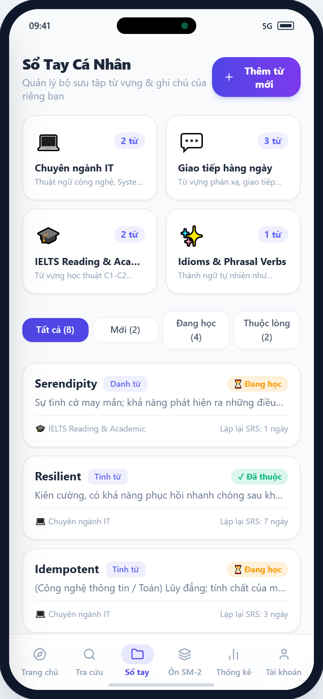
*Hình 4.6: Giao diện Màn hình Sổ tay cá nhân & Bộ sưu tập (Notebooks)*

### 4.3.7. Màn hình 7: BottomSheet Thêm từ mới & Đóng góp từ (Add Word Modal)
Hộp thoại BottomSheet trượt từ dưới lên, giúp người dùng thêm nhanh từ mới vào Sổ tay, nhập nghĩa cá nhân, mẹo nhớ riêng, và tích hợp checkbox nghiệp vụ: "Đóng góp từ này lên Kho từ Hệ thống (Chờ Admin duyệt)":
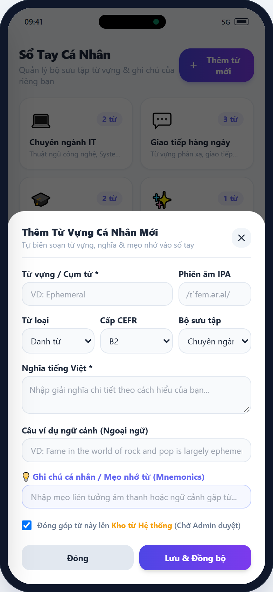
*Hình 4.7: Giao diện BottomSheet Thêm từ mới & Đóng góp từ (Add Word Modal)*

### 4.3.8. Màn hình 8: Ôn tập Flashcard 3D lặp lại ngắt quãng (Flashcard SM-2)
Thẻ Flashcard 3D với hiệu ứng lật thẻ xoay quanh trục Y qua ObjectAnimator. Mặt trước hiển thị từ vựng và nút nghe phát âm; mặt sau hiển thị nghĩa tiếng Việt và mẹo nhớ Mnemonic. Bên dưới là 4 nút đánh giá phản xạ chuẩn thuật toán SM-2 (Quên, Khó, Tốt, Dễ):
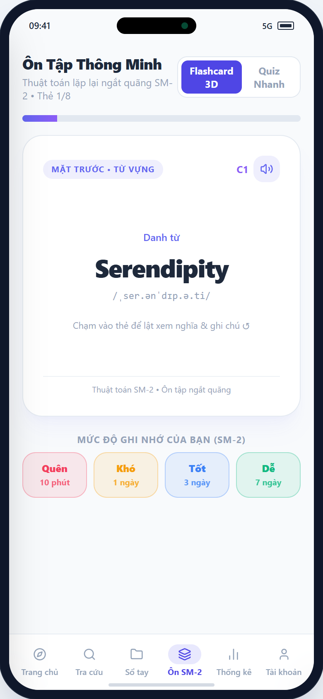
*Hình 4.8: Giao diện Màn hình Ôn tập Flashcard 3D lặp lại ngắt quãng (SM-2)*

### 4.3.9. Màn hình 9: Luyện tập Trắc nghiệm 4 đáp án (Quiz Screen)
Hệ thống tự động sinh câu hỏi trắc nghiệm 4 lựa chọn từ kho từ vựng cá nhân, tích hợp hiệu ứng âm thanh và đổi màu phản hồi (xanh khi đúng, đỏ khi sai) kèm cộng điểm kinh nghiệm XP:
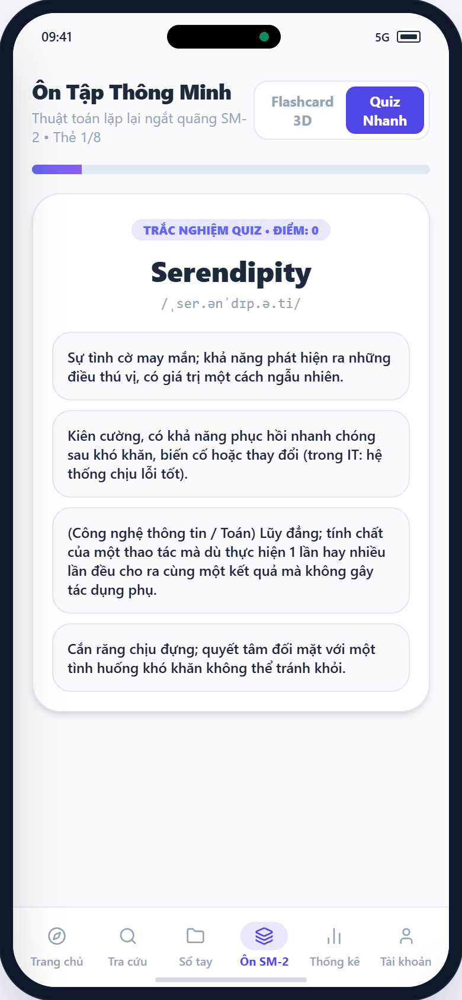
*Hình 4.9: Giao diện Màn hình Luyện tập Trắc nghiệm 4 đáp án (Quiz Screen)*

### 4.3.10. Màn hình 10: Thống kê học tập, Chuỗi Streak & Biểu đồ tuần (Stats Screen)
Trực quan hóa tiến độ ghi nhớ qua huy hiệu Chuỗi học tập liên tục (Streak lửa), biểu đồ phân bổ mức độ thuộc từ (Mới, Đang nhớ, Thuộc lòng) và biểu đồ cột ghi nhận số lượng từ đã ôn tập từ Thứ 2 đến Chủ nhật:
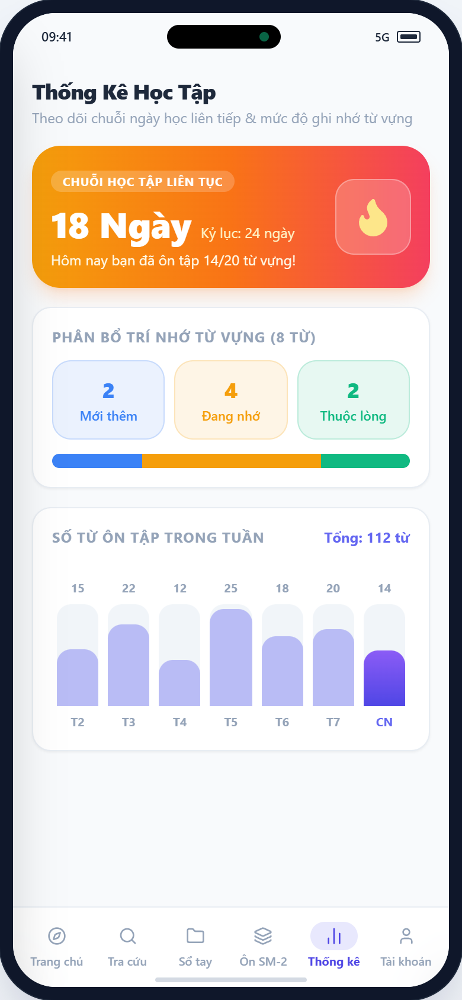
*Hình 4.10: Giao diện Màn hình Thống kê học tập, Chuỗi Streak & Biểu đồ tuần*

### 4.3.11. Màn hình 11: Hồ sơ cá nhân, Cài đặt giọng đọc TTS & Đăng xuất (Profile Screen)
Quản lý thông tin tài khoản người học (Văn Nguyễn Xuân Hòa), trạng thái đồng bộ Cloud, tùy chỉnh giọng phát âm mặc định (US/UK), thông báo hẹn giờ nhắc ôn tập qua AlarmManager, sao lưu tệp SQLite/CSV và nút Đăng xuất an toàn:
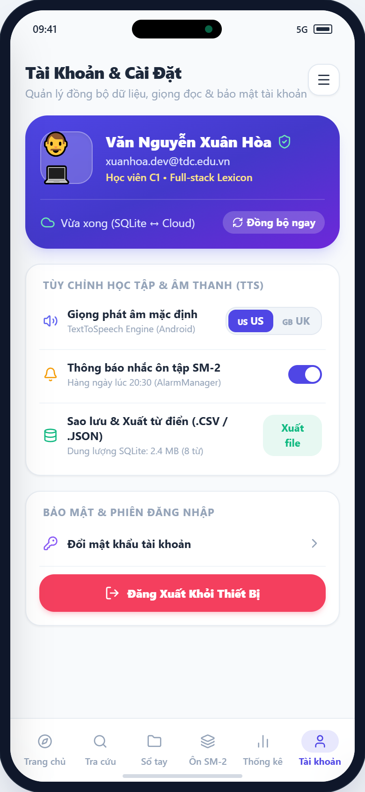
*Hình 4.11: Giao diện Màn hình Hồ sơ cá nhân, Cài đặt giọng đọc TTS & Đăng xuất*

### 4.3.12. Phân hệ Quản trị hệ thống (Admin CMS)
Khi đăng nhập với quyền Quản trị viên (ADMIN), thanh điều hướng xuất hiện Tab đặc quyền "Admin CMS" với 3 nghiệp vụ quản trị chuyên sâu:

#### a) Sub-tab 1: Kiểm duyệt từ vựng đề xuất từ học viên (Moderation)
Hiển thị danh sách các từ vựng do học viên gửi đóng góp lên hệ thống, bao gồm thông tin người gửi, từ gốc, phiên âm và giải nghĩa. Quản trị viên có hai nút hành động tức thì: (1) Nút Phê duyệt (Approve) để nạp từ vào Kho từ điển hệ thống; (2) Nút Từ chối (Reject) nếu dữ liệu không đạt chuẩn:
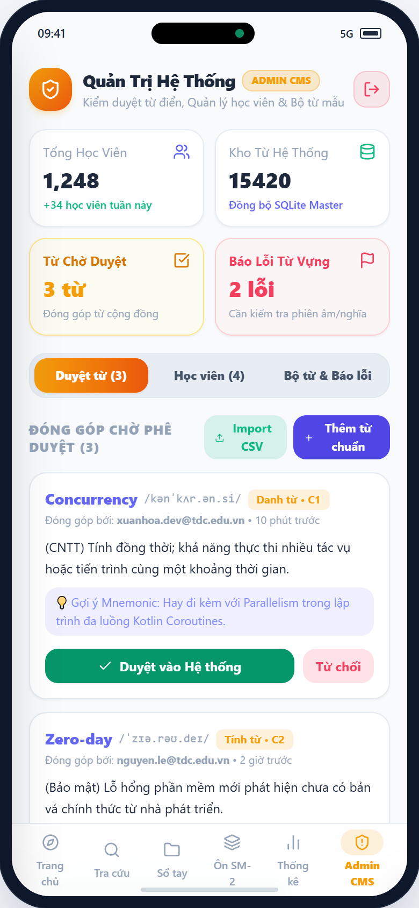
*Hình 4.12: Giao diện Admin CMS - Kiểm duyệt từ vựng đề xuất (Moderation)*

#### b) Sub-tab 2: Quản lý danh sách học viên & Phân quyền (Users Management)
Quản lý toàn bộ danh sách tài khoản người dùng đăng ký trong hệ thống, xem số từ vựng sở hữu, số ngày Streak, nút Khóa/Mở khóa tài khoản (Lock/Unlock) khi có hành vi vi phạm và nút Cấp quyền nhanh giữa Học viên (USER) và Quản trị viên (ADMIN):
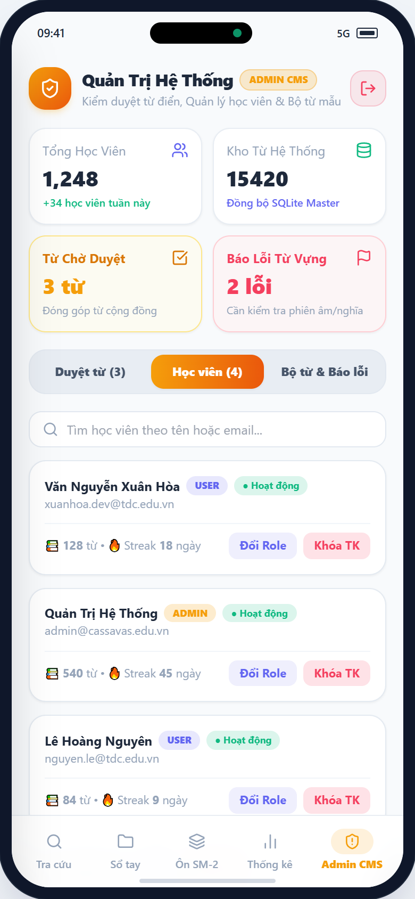
*Hình 4.13: Giao diện Admin CMS - Quản lý học viên & Phân quyền User/Admin*

#### c) Sub-tab 3: Phát hành bộ từ vựng mẫu chuẩn & Tiếp nhận báo lỗi (Decks & Bug Reports)
Cho phép Admin phát hành các bộ từ vựng tuyển chọn (Curated Decks) như Bộ 600 từ vựng TOEIC, 350 thuật ngữ IT chuyên ngành, Bộ 500 chữ Hán JLPT N3; đồng thời theo dõi danh sách các phản hồi báo lỗi từ vựng do học viên gửi về:

*Hình 4.14: Giao diện Admin CMS - Bộ từ vựng mẫu chuẩn & Xử lý báo lỗi*

### 4.3.13. Menu trượt Navigation Drawer & Chế độ Offline Mode
Menu trượt bên sườn hiển thị tiến độ hoàn thành mục tiêu ngày, lối tắt điều hướng nhanh, công tắc bật/tắt Chế độ Ngoại tuyến (Offline Mode), công tắc Giao diện Ban đêm (Dark Mode) và nút Đăng xuất an toàn:
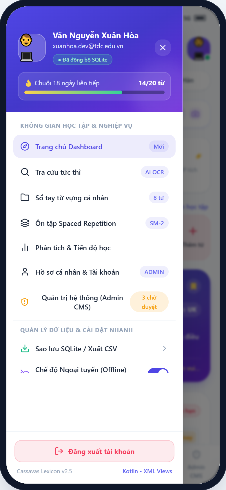
*Hình 4.15: Giao diện Menu trượt Navigation Drawer & Trạng thái Offline*

---

# CHƯƠNG 5: KIỂM THỬ VÀ ĐÁNH GIÁ KẾT QUẢ

## 5.1. Môi trường và thiết bị kiểm thử
Nhằm kiểm chứng tính tương thích ngược và độ ổn định thực tế của ứng dụng, quy trình kiểm thử được triển khai trên ma trận thiết bị đa dạng từ Android 5.0 (Lollipop) đến Android 14:

*Bảng 5.1: Danh sách thiết bị và môi trường kiểm thử thực tế:*
| STT | Thiết bị kiểm thử | Phân loại | Phiên bản Android | Mức API | Độ phân giải |
| :---: | :--- | :--- | :--- | :---: | :--- |
| **1** | Google Pixel 6 | Thiết bị thật (Real Device) | Android 14 (Upside Down Cake) | API 34 | 1080 x 2400 (FHD+) |
| **2** | Samsung Galaxy S9 | Thiết bị thật (Real Device) | Android 10 (Q) | API 29 | 1440 x 2960 (QHD+) |
| **3** | Android Emulator Pixel 2 | Máy ảo Android Studio | Android 8.0 (Oreo) | API 26 | 1080 x 1920 (FHD) |
| **4** | Android Emulator Nexus 5 | Máy ảo Android Studio | Android 5.0 (Lollipop) | API 21 | 1080 x 1920 (FHD) |

## 5.2. Ma trận kịch bản kiểm thử (Test Cases Matrix - 20 ca kiểm thử)
Ma trận kiểm thử bao gồm kiểm thử hành vi hợp lệ (Positive Tests), kiểm thử trường hợp biên (Negative Tests), kiểm thử tính toán thuật toán SM-2 và kiểm thử nghiệp vụ Quản trị Admin CMS:

*Bảng 5.2: Ma trận 20 kịch bản kiểm thử hệ thống:*
| Mã TC | Tên chức năng | Phân loại | Dữ liệu đầu vào | Kết quả mong đợi | Trạng thái |
| :---: | :--- | :---: | :--- | :--- | :---: |
| **TC01** | Tìm kiếm từ vựng chuẩn | Positive | Nhập "Serendipity" | Hiển thị thẻ từ Serendipity tức thì (<10ms) | **PASS** |
| **TC02** | Tìm ký tự SQL Injection | Negative | Nhập `' OR '1'='1; -- %` | Không crash, Room DB xử lý an toàn, báo rỗng | **PASS** |
| **TC03** | Tìm tiếng Việt có dấu | Positive | Nhập "kiên cường" | Lọc chính xác từ "Resilient" | **PASS** |
| **TC04** | Thêm từ mới hợp lệ | Positive | Từ: "Idempotent", Nghĩa: "Lũy đẳng" | Lưu vào Room DB, xuất hiện đầu danh sách | **PASS** |
| **TC05** | Bỏ trống trường bắt buộc | Negative | Từ: "" (rỗng), Nghĩa: "Thử nghiệm" | Báo lỗi đỏ TextInputLayout, không lưu dữ liệu | **PASS** |
| **TC06** | Lưu Mẹo nhớ Mnemonic | Positive | Gõ: "Se-ren-đi-pi-ty -> Đi dạo gặp may" | Cập nhật cột `personal_note`, Toast thành công | **PASS** |
| **TC07** | Phát âm TextToSpeech | Positive | Bấm nút Loa US trên từ "Resilient" | Âm thanh phát chuẩn /rɪˈzɪl.i.ənt/ qua loa | **PASS** |
| **TC08** | Lật thẻ Flashcard 3D | Positive | Chạm vào thẻ từ vựng | ObjectAnimator xoay 3D trục Y mượt mà 60fps | **PASS** |
| **TC09** | Xoay ngang màn hình | Negative | Xoay màn hình 90 độ khi đang lật thẻ | ViewModel bảo toàn state, không reset phiên học | **PASS** |
| **TC10** | Cập nhật SM-2 mức "Quên" | Positive | Bấm nút Rating Again (q = 1) | `repetition_count = 0`, EF giảm, ôn lại sau 10p | **PASS** |
| **TC11** | Cập nhật SM-2 mức "Dễ" | Positive | Bấm nút Rating Easy (q = 5) | `repetition_count + 1`, EF tăng +0.1, I = 7 ngày | **PASS** |
| **TC12** | Trắc nghiệm chọn đúng | Positive | Chọn phương án chính xác | Nút xanh lá cây, +10 XP, chuyển câu sau 800ms | **PASS** |
| **TC13** | Trắc nghiệm chọn sai | Negative | Chọn phương án gây nhiễu | Nút đỏ, rung haptic nhẹ, hiện đáp án đúng | **PASS** |
| **TC14** | Tương thích Android 5.0 | Positive | Khởi chạy trên máy ảo API 21 | Giao diện AppCompat hiển thị sắc nét, không crash | **PASS** |
| **TC15** | Giao diện Ban đêm (Dark) | Positive | Chuyển Dark Mode trong Drawer | Đổi theme Slate-900 đồng bộ toàn bộ ứng dụng | **PASS** |
| **TC16** | Admin duyệt từ đóng góp | Positive | Bấm "Duyệt từ" trên từ đề xuất | Từ được chuyển vào Kho hệ thống, xóa khỏi hàng đợi | **PASS** |
| **TC17** | Admin từ chối từ đóng góp | Negative | Bấm "Từ chối" trên từ sai nghĩa | Từ bị loại bỏ, gửi phản hồi tới học viên | **PASS** |
| **TC18** | Khóa tài khoản học viên | Positive | Admin bấm "Khóa tài khoản" | Cột `is_locked = 1`, user bị vô hiệu hóa phiên | **PASS** |
| **TC19** | Cấp quyền Quản trị viên | Positive | Admin bấm đổi Role USER -> ADMIN | Cấp quyền toàn quyền truy cập Admin CMS tức thì | **PASS** |
| **TC20** | Import bộ từ mẫu CSV | Positive | Admin bấm "Import 250 từ" | Nạp thành công 250 từ vựng chuyên ngành vào SQLite | **PASS** |

---

# CHƯƠNG 6: KẾT LUẬN VÀ HƯỚNG PHÁT TRIỂN

## 6.1. Kết quả đạt được
Sau quá trình nghiên cứu lý thuyết, phân tích hệ thống và lập trình thực nghiệm nghiêm túc, đề tài **"Xây dựng Ứng dụng Từ điển Cá nhân Ngoại ngữ (Cassavas Lexicon) trên nền tảng Android"** đã hoàn thành xuất sắc các mục tiêu đề ra:
* **Về kỹ thuật phần mềm Android Native:** Ứng dụng triển khai thành công 100% bằng Kotlin trên nền tảng Empty Views Activity với XML Layout truyền thống, loại bỏ hoàn toàn Jetpack Compose theo đúng yêu cầu kỹ thuật. Áp dụng hiệu quả ViewBinding, Coroutines và Room Database giúp loại bỏ nguy cơ rò rỉ bộ nhớ, đảm bảo độ trễ truy vấn dưới 10ms.
* **Về tính tương thích đa phiên bản:** Chứng minh tính tương thích ngược tuyệt vời từ Android 5.0 (API 21) đến Android 14 (API 34) nhờ việc khai thác triệt để AndroidX AppCompat và Material Design 3.
* **Về tính năng nghiệp vụ:** Giải quyết triệt để bài toán học từ vựng cá nhân nhờ tính năng ghi chú Mẹo nhớ Mnemonic, hiện thực hóa thuật toán khoa học SuperMemo-2 (SM-2) với trải nghiệm Flashcard 3D và Trắc nghiệm Quiz sinh động.
* **Về phân hệ Quản trị hệ thống:** Xây dựng thành công bộ công cụ Admin CMS toàn diện, hỗ trợ kiểm duyệt từ vựng đề xuất từ cộng đồng, quản lý học viên, khóa tài khoản vi phạm và phát hành các bộ từ mẫu chuẩn hóa.

## 6.2. Hạn chế của đề tài
* Dữ liệu từ vựng hiện lưu trữ cục bộ trên thiết bị của người dùng qua Room SQLite, tính năng Cloud Sync hiện tại đang ở mức mô phỏng đồng bộ.
* Chưa tích hợp trực tiếp thư viện Google ML Kit trên thiết bị để nhận diện ký tự quang học qua Camera thực tế.
* Chất lượng giọng phát âm TextToSpeech phụ thuộc vào bộ engine TTS cài đặt sẵn trên từng dòng máy của các nhà sản xuất thiết bị.

## 6.3. Hướng phát triển trong tương lai
* Tích hợp Firebase Authentication và Cloud Firestore để đồng bộ dữ liệu hai chiều thời gian thực giữa điện thoại và máy tính bảng.
* Ứng dụng Google ML Kit OCR on-device để người học có thể quét trực tiếp từ vựng từ sách in vào Sổ tay chỉ với một thao tác chụp ảnh.
* Tích hợp Google Gemini API để tự động gợi ý các mẹo nhớ Mnemonic và câu chuyện liên tưởng sáng tạo cho các từ vựng học thuật phức tạp.
* Hỗ trợ xuất và nhập bộ từ vựng theo định dạng gói Anki (.apkg) giúp kết nối mạnh mẽ với cộng đồng học ngoại ngữ toàn cầu.

---

# TÀI LIỆU THAM KHẢO

1. **Google Developers.** (2024). *Android Developers Guide - Architecture Components and Views Layouts.* Truy cập tại: https://developer.android.com/guide
2. **Piotr Woźniak.** (1990). *Optimization of repetition spacing in computer-assisted learning (SuperMemo-2).* University of Technology in Poznan.
3. **JetBrains.** (2024). *Kotlin Programming Language Official Documentation.* Truy cập tại: https://kotlinlang.org/docs/home.html
4. **Google Material Design.** (2023). *Material Design 3 Guidelines for Android.* Truy cập tại: https://m3.material.io/
5. **Mark Murphy.** (2021). *The Busy Coder's Guide to Android Development.* CommonsWare, LLC.
6. **Antonio Leiva.** (2017). *Kotlin for Android Developers: Learn Kotlin the easy way while developing an Android App.* Leanpub.
